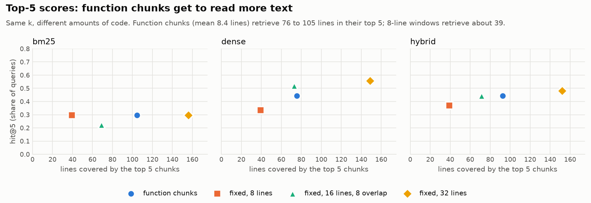
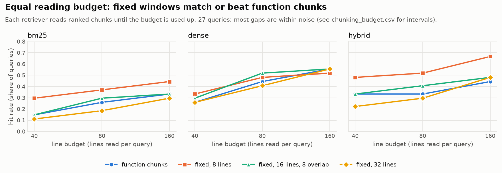

# SolidityRAG

> A benchmark-first retrieval toolkit for smart contract security auditing.

SolidityRAG helps an LLM audit Solidity code by retrieving the right evidence first. It splits contracts into function-level chunks that keep their structure, retrieves them with keyword search, dense embeddings, or both fused together, and asks an LLM to write findings that cite the code they rest on. A built-in evaluation harness scores each retrieval method against labeled vulnerabilities, so you can measure whether a change actually helps instead of guessing.

**Status: v0.1, a working prototype.** The pipeline runs end to end, but read [Limitations](#limitations) before trusting any number.

## What makes it different

- **Solidity-aware chunking.** One chunk per function, modifier or constructor, tagged with its contract, name and line range, instead of fixed-size text windows that cut functions in half. A fixed-size window chunker is included as a baseline, and so far it scores about as well (see [Chunking baseline](#chunking-baseline)).
- **Evaluation first.** Every retriever runs against the same labeled data with the same metrics, so "hybrid beats keyword search" is something you can check, not something you assume.
- **Evidence you can verify.** The LLM must cite numbered evidence blocks, and a citation checker flags any reference to evidence that was never provided.

## Quickstart

You need Python 3.10 or newer. An Anthropic API key is only needed for the `ask` command.

```bash
git clone https://github.com/<your-username>/SolidityRAG.git
cd SolidityRAG
python -m venv .venv && source .venv/bin/activate
pip install -e ".[embed,llm]"        # or: uv pip install -e ".[embed,llm]"
```

The `embed` extra installs sentence-transformers (and PyTorch), which is large. Skip it to run BM25 only.

Get the benchmark data. It is not bundled with this repo:

```bash
git clone https://github.com/smartbugs/smartbugs-curated data/smartbugs-curated
git -C data/smartbugs-curated rev-parse HEAD     # record this commit with your results
```

Build the index, ask a question, and run the evaluation:

```bash
# 1. Chunk the corpus and build the BM25 and dense indexes (embeddings are cached on disk)
solidityrag index data/smartbugs-curated/dataset

# 2. Ask a question about a contract or a whole directory
export ANTHROPIC_API_KEY=your_key
solidityrag ask data/smartbugs-curated/dataset/reentrancy \
    "Which function sends ether before updating state, and how could it be exploited?"

# 3. Compare bm25, dense and hybrid retrieval against the annotated vulnerable lines
solidityrag eval --out benchmarks/v0.1/results.csv
```

`solidityrag index --no-embed` builds a BM25-only index with no model download. `index --chunker fixed --window 8 --overlap 0` builds the fixed-size baseline instead of function chunks. `ask` takes `--retriever bm25|dense|hybrid` and `--k` for the number of chunks.

## Example

<!-- TODO: paste one real `solidityrag ask` output here: the answer, the evidence list and the citation line. -->

## Results

Function-level chunks, top 5 results, from `benchmarks/v0.2/chunking_summary.csv`:

| Retriever | Precision@5 | Hit@5 |
|---|---|---|
| bm25 | 0.126 | 0.296 |
| dense | 0.156 | 0.444 |
| hybrid | 0.163 | 0.444 |

Macro average over the 9 SmartBugs Curated categories, 3 query paraphrases per category. Dataset commit: `230e649123477eff332742a59a1c7cc6dc286cab`. Embedding model: `BAAI/bge-small-en-v1.5`.

A retrieved chunk counts as relevant to a category if its line range covers an annotated vulnerable line of that category. Precision@5 is the share of the top 5 that is relevant, and hit@5 is whether at least one is. Treat these numbers as a pipeline check, not a claim about detection ability (see below).

### Chunking baseline

`scripts/chunking_baseline.py` compares function chunks with fixed-size line windows (8, 16 and 32 lines, each with no overlap and with 50% overlap). The corpus, embedding model, queries and annotations are the same for every configuration.

```bash
python scripts/chunking_baseline.py data/smartbugs-curated --out benchmarks/v0.2
```

**Top-k scores are not a fair comparison between chunkers.** Bigger chunks cover more lines, so they hit labeled lines more often without being better. Function chunks also retrieve more text than their size suggests: the mean function is 8.4 lines, but the top 5 cover 76 to 105 lines, because both retrievers favor long functions. The fair comparison gives every chunker the same reading budget. Each retriever reads ranked chunks until a fixed number of source lines is used up.





To redraw the figures: `pip install -e ".[plot]"`, then `python scripts/plot_chunking.py benchmarks/v0.2`.

Hit rate with an 80-line budget, over 27 queries (from `benchmarks/v0.2/chunking_budget.csv`):

| Chunker | bm25 | dense | hybrid |
|---|---|---|---|
| function | 0.259 | 0.444 | 0.333 |
| fixed, 8 lines | 0.370 | 0.481 | 0.519 |
| fixed, 16 lines, 8 overlap | 0.296 | 0.519 | 0.407 |
| fixed, 32 lines | 0.185 | 0.407 | 0.296 |

At this budget, function chunking does not beat fixed windows, and 8-line windows score slightly higher. Most paired 95% bootstrap intervals for the difference include zero, so 27 queries cannot separate the chunkers. One exception: at 80 lines, hybrid retrieval over 8-line windows finds more labeled vulnerable lines than over function chunks (1.81 vs 1.04, interval -1.26 to -0.33 for function minus fixed). Until the query set is larger, the benefit of Solidity-aware chunking is unproven on this benchmark. Dataset commit: `230e649123477eff332742a59a1c7cc6dc286cab`.

## How it works

```
.sol files -> chunker -> index (BM25 + dense) -> retrievers (bm25 | dense | hybrid) -> LLM with [C#] citations
                                                       |
                                             evaluation harness (scores each retriever)
```

| Module | Role |
|---|---|
| `ingest/chunker.py` | one chunk per function, modifier or constructor, with contract, name and line range |
| `ingest/fixed.py` | fixed-size line windows, the structure-unaware baseline |
| `ingest/smartbugs.py` | loads the labeled vulnerable lines used as ground truth |
| `index/` | embedder interface, sentence-transformers backend, saved index |
| `retrieve/` | BM25, dense and hybrid retrievers behind one interface |
| `generate/` | prompt with labeled evidence blocks, LLM call, citation check |
| `eval/` | query set, relevance rule, precision@k and hit@k |

Design choices worth knowing:

- **Hybrid retrieval uses reciprocal rank fusion.** BM25 scores and cosine similarities are not comparable, but ranks are, so fusion needs no tuned weights.
- **BM25 uses a positive IDF.** The stock formula scores a term that appears in one of two documents as exactly zero, so on a small corpus (such as a single contract) matching chunks can return nothing. This project uses the always-positive Lucene-style formula.
- **Dataset labels are stripped before indexing.** SmartBugs files contain comments such as `// <yes> <report> REENTRANCY` that name the answer, and many `@source` header URLs name the category (`.../integer_overflow_minimal.sol`). Both are removed from everything that is indexed or shown to the model, along with `@author` lines. Function chunks never include file headers, but fixed-size windows do.
- **Evidence labels are short.** The prompt uses `[C1]`, `[C2]` and so on instead of file paths, because models copy long identifiers unreliably.

You can also use the pieces as a library:

```python
from solidityrag.ingest import load_chunks
from solidityrag.index import Index
from solidityrag.retrieve import BM25Retriever

chunks = load_chunks("data/smartbugs-curated/dataset").chunks
index = Index.build(chunks)                      # BM25 only; pass an embedder for dense
for r in BM25Retriever(index).search("external call before balance update", k=3):
    print(r.rank, r.chunk.id, round(r.score, 2))
```

## Limitations

- **The chunker is not a real parser.** It strips comments and strings and matches braces with a regex. It handles the SmartBugs corpus, but unusual syntax can break it. `index` prints any files that produce no chunks.
- **Data contamination.** SmartBugs contracts are public and old, so they are very likely in LLM training data. Results from `ask`, and any claim about detection ability, should be read with that in mind.
- **Small categories are noisy.** Some categories have very few annotated chunks (`short_addresses` has one). `eval` prints the number of relevant chunks per category so you can see which scores mean little.
- **The query set is small.** Three hand-written paraphrases per category, fixed before running. Do not tune them against the metrics.
- **Long functions are truncated.** The default embedding model reads at most 512 tokens, so the end of a long function may not be embedded.
- **Only one baseline so far.** Fixed-size chunking is in place. It scores about as well as function chunking, with no difference the 27-query set can resolve. There is no LLM-only baseline yet.

## Roadmap

In this order, each item only after the previous one is measured:

1. Baselines: an LLM-only mode, and a larger query set so the chunking comparison can resolve differences. Fixed-size chunking is done.
2. Structural expansion: pull in callers, callees and parent contracts of the top results.
3. A tree-sitter parser behind the same `Chunk` interface.
4. A reranker.
5. A security knowledge base (SWC Registry first, then public audit reports), split so retrieval never draws on the contracts being evaluated.

## Development

```bash
pip install -e ".[dev]"
pytest
```

The tests use a fake embedder and a fake LLM client, so they need no model download and no API key.

## Data and licensing

The benchmark data comes from [SmartBugs Curated](https://github.com/smartbugs/smartbugs-curated). It is not bundled here. Clone it yourself and follow its license.

