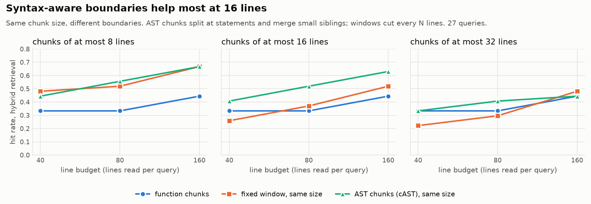

# SolidityRAG

> A benchmark-first retrieval toolkit for smart contract security auditing.

SolidityRAG helps an LLM audit Solidity code by retrieving the right evidence first. It splits contracts into chunks that follow their syntax, retrieves them with keyword search, dense embeddings, or both fused together, and asks an LLM to write findings that cite the code they rest on. A built-in evaluation harness scores each retrieval method against labeled vulnerabilities, so you can measure whether a change actually helps instead of guessing.

**Status: v0.1, a working prototype.** The pipeline runs end to end, but read [Limitations](#limitations) before trusting any number.

## What makes it different

- **Solidity-aware chunking, measured against a baseline.** Three chunkers (whole functions, fixed-size windows, and size-bounded syntax chunks from a tree-sitter parse) are compared on the same benchmark. Syntax chunks score best so far (see [Chunking strategies](#chunking-strategies) and [Results](#results)).
- **Evaluation first.** Every retriever runs against the same labeled data with the same metrics, so "hybrid beats keyword search" is something you can check, not something you assume.
- **Evidence you can verify.** The LLM must cite numbered evidence blocks, and a citation checker flags any reference to evidence that was never provided.

## Quickstart

You need Python 3.10 or newer. An Anthropic API key is only needed for the `ask` command.

```bash
git clone https://github.com/<your-username>/SolidityRAG.git
cd SolidityRAG
python -m venv .venv && source .venv/bin/activate
pip install -e ".[embed,llm]"        # or: uv pip install -e ".[embed,llm]"
```

The `embed` extra installs sentence-transformers (and PyTorch), which is large. Skip it to run BM25 only.

Get the benchmark data. It is not bundled with this repo:

```bash
git clone https://github.com/smartbugs/smartbugs-curated data/smartbugs-curated
git -C data/smartbugs-curated rev-parse HEAD     # record this commit with your results
```

Build the index, ask a question, and run the evaluation:

```bash
# 1. Chunk the corpus and build the BM25 and dense indexes (embeddings are cached on disk)
solidityrag index data/smartbugs-curated/dataset

# 2. Ask a question about a contract or a whole directory
export ANTHROPIC_API_KEY=your_key
solidityrag ask data/smartbugs-curated/dataset/reentrancy \
    "Which function sends ether before updating state, and how could it be exploited?"

# 3. Compare bm25, dense and hybrid retrieval against the annotated vulnerable lines
solidityrag eval --out benchmarks/v0.1/results.csv
```

`solidityrag index --no-embed` builds a BM25-only index with no model download. `--chunker` picks the chunking strategy (see [Chunking strategies](#chunking-strategies)): `function` (default), `ast --window 16` or `fixed --window 8`. `ask` takes `--retriever bm25|dense|hybrid` and `--k` for the number of chunks.

## Example

<!-- TODO: paste one real `solidityrag ask` output here: the answer, the evidence list and the citation line. -->

## Chunking strategies

Retrieval can only return what the chunker produced. If a vulnerable line ends up in a chunk that is mostly unrelated code, or is cut away from the code that explains it, no retriever can find it reliably. SolidityRAG has three chunkers that can be compared on the same benchmark.

| Chunker | Flag | Splits at | Chunk size | Covers | Header in the indexed text |
|---|---|---|---|---|---|
| Function (default) | `--chunker function` | function, modifier and constructor boundaries | as long as the function (mean 8.4 lines, up to 89) | function bodies only | `// Contract.function` |
| Fixed-size windows (baseline) | `--chunker fixed --window N --overlap M` | every N lines, ignoring the code | N lines | the whole file | none |
| AST (cAST) | `--chunker ast --window N` | syntax nodes: members, then statements | at most N lines | the whole file | `// Contract.function` |

### Function chunks

One chunk per function, modifier, constructor, fallback or receive function that has a body. Comments and strings are blanked out, declarations are found with a regex, and each body is matched by counting braces. No compiler is needed, so old contracts with missing imports still work.

Every chunk is a complete unit. Their sizes vary a lot, though: a one-line getter and a 90-line function are each one chunk. `--chunker ast-function` produces the same chunks from a tree-sitter parse. On SmartBugs Curated, both give the same 993 chunks, with identical line ranges and text.

### Fixed-size windows: the baseline

The file is cut into windows of N lines, moving N − M lines each time (M is the overlap). The windows know nothing about Solidity. They cover everything, including pragmas, state variables and comments, and they carry no contract or function header, because that structure is exactly what the baseline should not have.

This is the standard first chunker in most RAG systems. It is the baseline: any Solidity-aware chunker has to beat it to justify its complexity.

### AST chunks

`--chunker ast` parses each file with [tree-sitter-solidity](https://github.com/JoranHonig/tree-sitter-solidity) and builds chunks of at most N lines, following cAST (Zhang et al., 2025):

1. A syntax node that fits in N lines is kept whole.
2. A node that is too large is split into its children, recursively: a contract into its members, a function into its statements, an `if` into its branches.
3. Consecutive small pieces are merged while they still fit in N lines, but never across contracts.

The result has the even size of a window and the clean boundaries of a function chunk. A long function becomes several pieces, each labeled with its function name. Small members, such as state variables and short getters, are grouped together. Needs the `ast` extra: `pip install -e ".[ast]"`.

### One contract, three ways

`reentrancy/simple_dao.sol` from SmartBugs, with the vulnerable call on line 19:

```solidity
 9  contract SimpleDAO {
10    mapping (address => uint) public credit;
11
12    function donate(address to) payable {
13      credit[to] += msg.value;
14    }
15
16    function withdraw(uint amount) {
17      if (credit[msg.sender]>= amount) {
18        // <yes> <report> REENTRANCY   (stripped before indexing)
19        bool res = msg.sender.call.value(amount)();
20        credit[msg.sender]-=amount;
21      }
22    }
23
24    function queryCredit(address to) returns (uint){
25      return credit[to];
26    }
27  }
```

| Chunker | Chunks (line ranges) | The chunk holding line 19 |
|---|---|---|
| Function | 12–14 `donate`, 16–22 `withdraw`, 24–26 `queryCredit` | 16–22: all of `withdraw` |
| Fixed, 8 lines | 1–8, 9–16, 17–24, 25–27 | 17–24: the body of `withdraw` without its signature, plus the first line of `queryCredit` |
| AST, at most 8 lines | 1–7 header, 9–14 contract start + `donate`, 16–22 `withdraw`, 24–27 `queryCredit` | 16–22: all of `withdraw` |

The function and AST chunkers keep `withdraw` whole. The window cuts it in two. In a file this small, functions already fit the budget, so the AST chunker behaves like the function chunker. The two differ on long functions, which the AST chunker splits at statement boundaries.

## How the chunkers are evaluated

**Data.** [SmartBugs Curated](https://github.com/smartbugs/smartbugs-curated): 143 contracts in 9 vulnerability categories, with the vulnerable lines labeled. Labels and other hints are stripped before indexing (see [Design choices](#how-it-works)).

**Queries.** 27 plain-language descriptions of vulnerable behavior, 3 per category (`src/solidityrag/eval/queries.yaml`). They were written before any results were seen and are not tuned against the metrics.

**Relevance.** A retrieved chunk is relevant to a query if it contains a labeled vulnerable line of that query's category.

**Metrics.**
- *Hit rate*: the share of queries where at least one relevant chunk is retrieved.
- *Vulnerable lines found* (`vlines`): distinct labeled lines inside the retrieved chunks. A line found by two overlapping chunks counts once.
- *Precision@k* and *hit@k*: the usual top-k scores, reported for completeness.

**Equal line budget.** Top-k scores are unfair across chunkers. Five large chunks contain more code than five small ones, so they hit labeled lines more often without being better at finding them. Function chunks are hit hardest: the mean function is 8.4 lines, yet the top 5 cover 76 to 105 lines, because both retrievers favor long functions.


So the main comparison gives every chunker the same reading budget. Each retriever takes chunks in rank order until it has read 40, 80 or 160 distinct source lines, which is roughly what an LLM would be shown.

**Uncertainty.** 27 queries is a small sample. Chunkers are compared query by query (paired), with a bootstrap 95% interval on the difference. A difference counts as real only if its interval excludes zero.

**Fixed settings.** Embedding model `BAAI/bge-small-en-v1.5`, hybrid retrieval by reciprocal rank fusion, dataset commit `230e649123477eff332742a59a1c7cc6dc286cab`.

To reproduce the experiment and the figures:

```bash
pip install -e ".[embed,ast,plot]"
python scripts/chunking_baseline.py data/smartbugs-curated --out benchmarks/v0.2
python scripts/plot_chunking.py benchmarks/v0.2
```

## Results

**Summary**
1. **Whole-function chunks are the weakest Solidity-aware option.** With the same reading budget, small fixed windows find as much or more. A long function uses up most of the budget on its own.
2. **AST chunks of 8 or 16 lines with hybrid retrieval are the best configurations**, tied with 8-line windows at 8 lines.
3. **AST chunks keep performing at larger sizes, while windows do not.** At 16 lines, AST chunks clearly beat windows of the same size.

Hit rate at an 80-line budget (`benchmarks/v0.2/chunking_budget.csv`, 27 queries; best in each column in bold):

| Chunker | bm25 | dense | hybrid |
|---|---|---|---|
| Function | 0.26 | 0.44 | 0.33 |
| Fixed, 8 lines | **0.37** | 0.48 | 0.52 |
| Fixed, 16 lines | 0.26 | 0.33 | 0.37 |
| Fixed, 32 lines | 0.19 | 0.41 | 0.30 |
| AST, at most 8 lines | **0.37** | **0.52** | **0.56** |
| AST, at most 16 lines | 0.26 | 0.48 | 0.52 |
| AST, at most 32 lines | 0.22 | 0.37 | 0.41 |

Labeled vulnerable lines found within the same 80-line budget:

| Chunker | bm25 | dense | hybrid |
|---|---|---|---|
| Function | 0.56 | 1.00 | 1.04 |
| Fixed, 8 lines | 0.96 | **1.56** | 1.81 |
| Fixed, 16 lines | 0.56 | 1.33 | 0.96 |
| Fixed, 32 lines | 0.56 | 0.96 | 0.67 |
| AST, at most 8 lines | 1.00 | 1.52 | 1.78 |
| AST, at most 16 lines | **1.30** | 1.22 | **2.07** |
| AST, at most 32 lines | 0.67 | 0.81 | 1.07 |

### Function chunks vs the fixed-size baseline


8-line windows match or beat function chunks at every budget for bm25 and hybrid. Most intervals include zero, but one does not: with hybrid retrieval at 80 lines, windows find 1.81 vulnerable lines against 1.04 for function chunks (interval for the difference: 0.33 to 1.26). Larger windows lose this advantage. 50% overlap did not help consistently. Those runs are in `chunking_budget.csv`.

### AST chunks vs fixed windows of the same size



`benchmarks/v0.2/chunking_ast_vs_fixed.csv` pairs each AST size with the window of the same size. Only the boundaries differ:

- **8 lines:** no reliable difference. Windows this small rarely cut anything important.
- **16 lines:** AST chunks are clearly better. With hybrid retrieval at 80 lines, the hit rate is 0.52 vs 0.37, and AST chunks find 2.07 vs 0.96 vulnerable lines (difference +1.11, interval +0.30 to +2.19). The gain holds at all three budgets and for bm25 as well.
- **32 lines:** smaller gains, mostly with hybrid retrieval.

### Top-5 scores

For reference, the usual top-5 scores with the lines those 5 chunks cover (`benchmarks/v0.2/chunking_summary.csv`, macro average over categories). Read hit@5 together with the line count: the high scores come from the chunkers that read the most code.

| Chunker | Retriever | Precision@5 | Hit@5 | Lines in top 5 |
|---|---|---|---|---|
| Function | bm25 | 0.126 | 0.296 | 105 |
| Function | dense | 0.156 | 0.444 | 76 |
| Function | hybrid | 0.163 | 0.444 | 93 |
| Fixed, 8 lines | hybrid | 0.126 | 0.370 | 39 |
| Fixed, 32 lines | dense | 0.222 | 0.556 | 149 |
| AST, at most 8 lines | hybrid | 0.133 | 0.407 | 34 |
| AST, at most 16 lines | hybrid | 0.141 | 0.370 | 64 |

### Caveats

- **Header confound.** AST chunks carry a `// Contract.function` header and windows do not. Part of the AST advantage may come from the header rather than the boundaries. The next experiment on the roadmap separates the two.
- **Small sample.** 27 queries and many comparisons, so a few intervals will exclude zero by chance. The 16-line AST result is the most credible, because it holds across budgets, metrics and retrievers.
- **Retrieval only.** These numbers measure whether the right code is retrieved, not whether an LLM then finds the bug.

## How it works

```
.sol files -> chunker -> index (BM25 + dense) -> retrievers (bm25 | dense | hybrid) -> LLM with [C#] citations
                                                       |
                                             evaluation harness (scores each retriever)
```

| Module | Role |
|---|---|
| `ingest/chunker.py` | one chunk per function, modifier or constructor, with contract, name and line range |
| `ingest/fixed.py` | fixed-size line windows, the structure-unaware baseline |
| `ingest/ast.py` | tree-sitter parse: function chunks, and size-bounded syntax chunks (cAST) |
| `ingest/smartbugs.py` | loads the labeled vulnerable lines used as ground truth |
| `index/` | embedder interface, sentence-transformers backend, saved index |
| `retrieve/` | BM25, dense and hybrid retrievers behind one interface |
| `generate/` | prompt with labeled evidence blocks, LLM call, citation check |
| `eval/` | query set, relevance rule, precision@k, hit@k, lines@k and vlines@k |
| `scripts/chunking_baseline.py` | the chunking experiment: every chunker, top-k and equal line budgets |
| `scripts/plot_chunking.py` | the figures in [Results](#results) |

Design choices worth knowing:

- **Hybrid retrieval uses reciprocal rank fusion.** BM25 scores and cosine similarities are not comparable, but ranks are, so fusion needs no tuned weights.
- **BM25 uses a positive IDF.** The stock formula scores a term that appears in one of two documents as exactly zero, so on a small corpus (such as a single contract) matching chunks can return nothing. This project uses the always-positive Lucene-style formula.
- **Dataset labels are stripped before indexing.** SmartBugs files contain comments such as `// <yes> <report> REENTRANCY` that name the answer, and many `@source` header URLs name the category (`.../integer_overflow_minimal.sol`). Both are removed from everything that is indexed or shown to the model, along with `@author` lines. Function chunks never include file headers, but fixed-size windows do.
- **Evidence labels are short.** The prompt uses `[C1]`, `[C2]` and so on instead of file paths, because models copy long identifiers unreliably.

You can also use the pieces as a library:

```python
from solidityrag.ingest import load_chunks
from solidityrag.index import Index
from solidityrag.retrieve import BM25Retriever

chunks = load_chunks("data/smartbugs-curated/dataset").chunks
index = Index.build(chunks)                      # BM25 only; pass an embedder for dense
for r in BM25Retriever(index).search("external call before balance update", k=3):
    print(r.rank, r.chunk.id, round(r.score, 2))
```

## Limitations

- **The default chunker is not a real parser.** `--chunker function` strips comments and strings and matches braces with a regex. On SmartBugs it gives exactly the same chunks as the tree-sitter parser, but unusual syntax can break it. `index` prints any files that produce no chunks. `--chunker ast-function` gives the same chunks from a real parse.
- **Data contamination.** SmartBugs contracts are public and old, so they are very likely in LLM training data. Results from `ask`, and any claim about detection ability, should be read with that in mind.
- **Small categories are noisy.** Some categories have very few annotated chunks (`short_addresses` has one). `eval` prints the number of relevant chunks per category so you can see which scores mean little.
- **The query set is small.** Three hand-written paraphrases per category, fixed before running. Do not tune them against the metrics.
- **Long functions are truncated.** The default embedding model reads at most 512 tokens, so the end of a long function may not be embedded.
- **Only one baseline so far.** Fixed-size chunking is in place. There is no LLM-only baseline yet.

## Roadmap

In this order, each item only after the previous one is measured:

1. Baselines: an LLM-only mode, and a larger query set so the chunking comparison can resolve differences. Fixed-size chunking is done.
2. Chunking ablation: AST chunks without the header, and windows with one, to separate the effect of boundaries from the effect of the header. Then make the best AST setting the default.
3. Structural expansion: pull in callers, callees and parent contracts of the top results, using the tree-sitter parse.
4. A reranker.
5. A security knowledge base (SWC Registry first, then public audit reports), split so retrieval never draws on the contracts being evaluated.

## Development

```bash
pip install -e ".[dev]"
pytest
```

The tests use a fake embedder and a fake LLM client, so they need no model download and no API key.

## Data and licensing

The benchmark data comes from [SmartBugs Curated](https://github.com/smartbugs/smartbugs-curated). It is not bundled here. Clone it yourself and follow its license.

